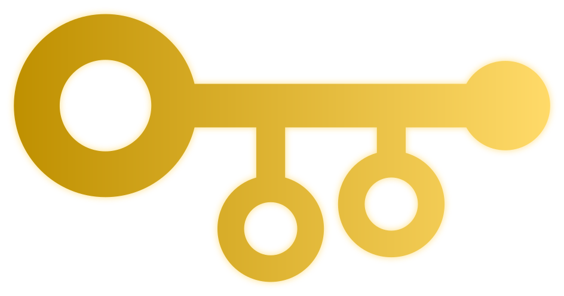
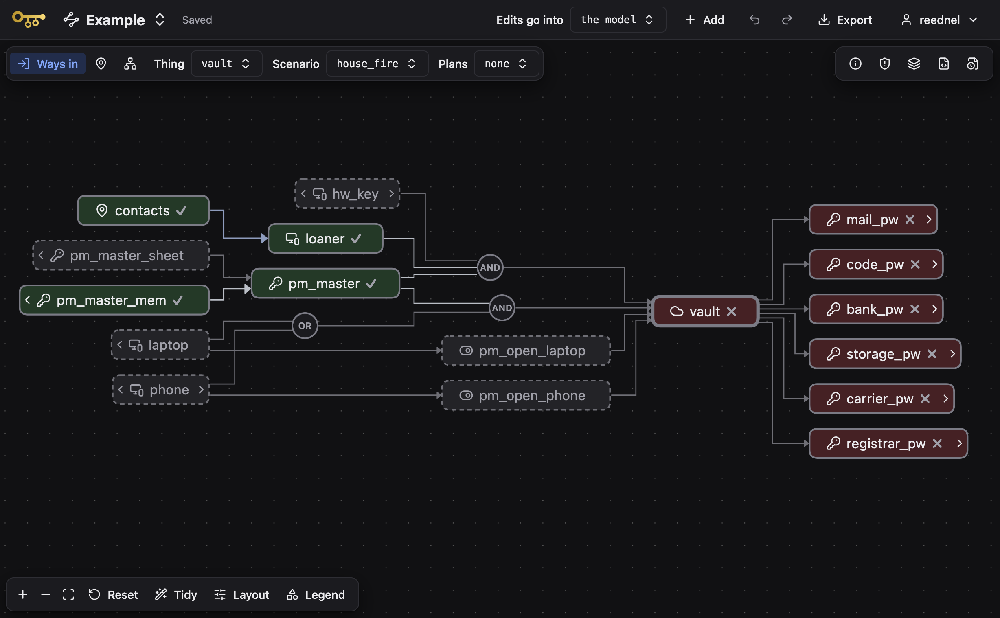

<p align="center">
  
</p>

<h1 align="center">ReachLine</h1>

<p align="center">
  <strong>Follow every line of access, and see who can reach what.</strong>
</p>

<p align="center">
  <a href="https://github.com/reachline/reachline/actions/workflows/ci.yml"></a>
  <a href="https://github.com/reachline/reachline/actions/workflows/codeql.yml"></a>
  <a href="https://github.com/reachline/reachline/releases"></a>
  <a href="https://github.com/reachline/reachline/issues?q=is%3Aissue%20is%3Aopen%20label%3Abug"></a>
  <br>
  <a href="LICENSE"></a>
  <a href="https://github.com/reachline/reachline/pkgs/container/reachline"></a>
  
  
</p>

<p align="center">
  <a href="https://reachline.github.io/reachline/">Documentation</a> ·
  <a href="https://reachline.github.io/reachline/self-hosting/">Self-hosting</a> ·
  <a href="https://reachline.github.io/reachline/cli/">CLI & Agents</a>
</p>

---

ReachLine maps everything that grants access in your digital life, and how it flows from one thing to the next. That covers devices, passwords, 2FA, recovery codes, accounts and data, and where each of them physically lives. From that map it answers two questions:

- **Lockout:** if I lose these things (a phone, a house fire, a forgotten password), what can I no longer get back?
- **Breach:** if someone takes these things (a stolen laptop, a SIM swap, a burglary), what else can they reach?

## A look

<p align="center">
  
</p>

This is a view of what happens to a password manager vault in a house fire scenario. The scenario defines everything in gray to be lost. Things in green are okay, and things in red are permanently lost as a consequence. In this case, an offsite backup hardware key would have saved everything in the password manager vault.

## How it works

Describe your setup in the UI, or in a hand-written YAML file:

```yaml
things:
  mail:
    kind: account                          # or location, device, secret, service, data, state
    check: [lockout, breach]               # report it if you lose it, or if an attacker gets it
    access: mail_pw and (mail_totp or hw_key)
    recovery: mail_codes or phone_number   # recovery codes, or an SMS reset

scenarios:
  sim_swap:
    kind: breach
    has: phone_number                      # what the attacker starts with
```

ReachLine follows every path, recovery included, and gives each checked thing a verdict, with the graph of why:

| Verdict     | Meaning                                                                                  |
| ----------- | ---------------------------------------------------------------------------------------- |
| **LOST**    | In a lockout, you can no longer reach it.                                                |
| **REACHED** | In a breach, the attacker reaches it.                                                    |
| **UNSURE**  | It hangs on something you marked `unknown`, because you don't know how it works.         |
| **DEPENDS** | It hangs on a condition of the moment, such as an app being unlocked.                    |

**Plans** answer "what changes if I do this?", such as adding a spare security key or replacing a sync with a backup, as a before/after for every scenario. They live in the same file, under `plans:`.

## What it's like

> ReachLine has helped me see see so many vulnerabilities, circular dependencies, and lockout scenarios that I otherwise wouldn't have, but you only get out of it as much as you put into it.

ReachLine is a super nifty tool if you actually cannot keep track of your whole digital access model in your head. The app does what it can to give structured concepts and examples to make it easier, but ultimately your model may require a lot of deep and rigorous thought, time spent digging through details of account settings, and thorough threat-modeling. ReachLine gives structured language and visuals to help you think about those things, but it can't do the thinking for you.

Admittedly, AI might be able to do that thinking for you, and there's a CLI tool for that reason, but still, the dopamine hit will be much deferred relative to most popular selfhosted services.

## Quick start

ReachLine runs on a server you own, with Docker Compose:

```sh
curl -O https://raw.githubusercontent.com/reachline/reachline/main/docker-compose.yml
curl -o .env https://raw.githubusercontent.com/reachline/reachline/main/.env.template
# set PUBLIC_URL in .env, then:
mkdir reachline-data
docker compose up -d
```

Open it on port 6060 and create your account. [Self-hosting](https://reachline.github.io/reachline/self-hosting/) covers HTTPS, single sign-on, backups and upgrades.

## The model

A model is one YAML document: your `things` (each with a `kind`, and the fields that say where it lives and how it's reached), the `scenarios` to run, what you have on a normal day (`me`), and `plans`. `examples/model.yml` is a made-up person's setup that uses every part of the format, and `examples/starter.yml` is a smaller place to start. Templates in `templates/` add a common service in one go.

The [docs](https://reachline.github.io/reachline/) explain how ReachLine thinks, how to model your setup, how to read the results, and every field.

## Development

Requires [Node.js](https://nodejs.org) and [pnpm](https://pnpm.io). The CLI needs Node 22.18 or newer, and the server needs 24.7 or newer.

### Setup

```sh
git clone https://github.com/reachline/reachline.git
cd reachline
pnpm i
```

### Running

```sh
pnpm dev                 # the server and the UI, at http://127.0.0.1:6060
pnpm dev:reset           # a fresh database in data/: user dev, password dev-password, and the example model
pnpm build && pnpm start # what the Docker image runs
```

The command line runs the engine on a model file: the synthetic example in `examples/`, or whichever `--model` names. From the repository it runs as `./reachline.ts`; `pnpm build` also bundles it into `app/dist/reachline.mjs`, which the server hands out.

```sh
./reachline.ts                    # every scenario
./reachline.ts house_fire         # one scenario
./reachline.ts thief_carried mail # how a scenario reaches one thing
./reachline.ts --todo             # open questions in the model
./reachline.ts --plan spare_key   # before/after a plan
./reachline.ts help               # everything else: login, pull, check, push, docs
```

### Checking

```sh
pnpm verify     # all of the below but test:e2e
pnpm check      # type-check the engine, CLI, server and UI
pnpm lint       # ESLint
pnpm format     # Prettier (format:check only checks)
pnpm test       # engine, CLI and server tests
pnpm test:e2e   # the built app in Chromium: user flows, the strict CSP, axe (needs pnpm build)
```

`pnpm install` sets up a pre-commit hook that checks the formatting of staged files. CI runs `pnpm verify` and `pnpm test:e2e`. For `test:e2e` locally, first run `pnpm exec playwright install chromium-headless-shell`. After a change to the engine, update the test snapshot with `node --test --test-update-snapshots "test/*.test.ts"`.

## Contributing

Contributions are welcome. Report bugs and ideas in the [issue tracker](https://github.com/reachline/reachline/issues), and see [CONTRIBUTING.md](CONTRIBUTING.md) for how to contribute. All contributors are expected to follow the [Code of Conduct](CODE_OF_CONDUCT.md). To report a vulnerability, see [SECURITY.md](SECURITY.md).

## License

This software is licensed under the [AGPL-3.0 license](LICENSE).

## Acknowledgements

Thank you to all of the projects ReachLine depends on to run:

- [CodeMirror](https://github.com/codemirror/dev) (model editor)
- [ELK](https://github.com/kieler/elkjs) (graph layout)
- [Hono](https://github.com/honojs/hono) (web server)
- [jose](https://github.com/panva/jose) and [openid-client](https://github.com/panva/openid-client) (auth)
- [Lucide](https://github.com/lucide-icons/lucide) (icons)
- [Node](https://github.com/nodejs/node)
- [SQLite](https://github.com/sqlite/sqlite)
- [Svelte](https://github.com/sveltejs/svelte)
- [Svelte Flow](https://github.com/xyflow/xyflow) (graph viewer)
- [yaml](https://github.com/eemeli/yaml)
